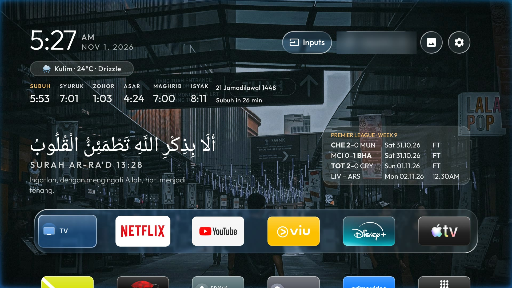
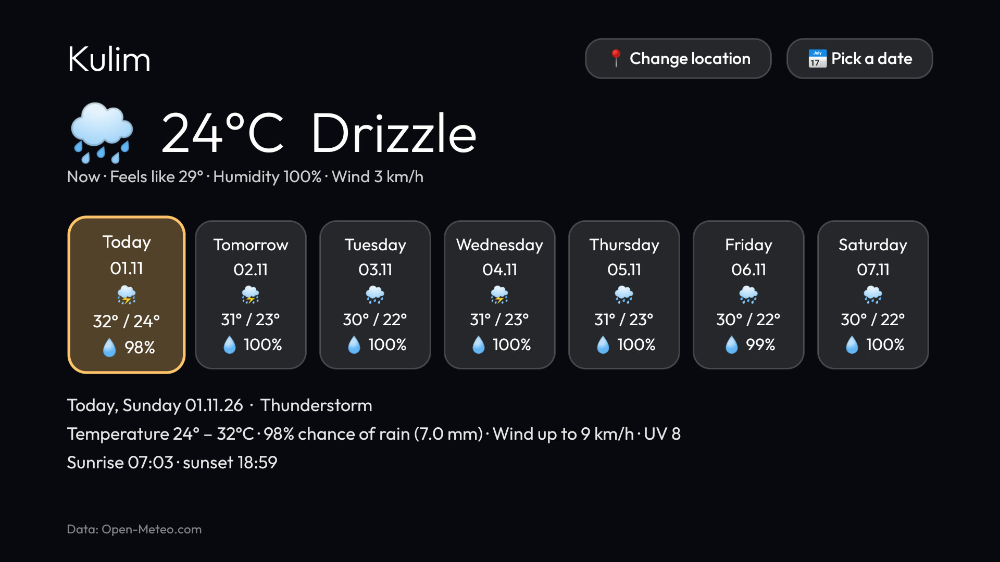
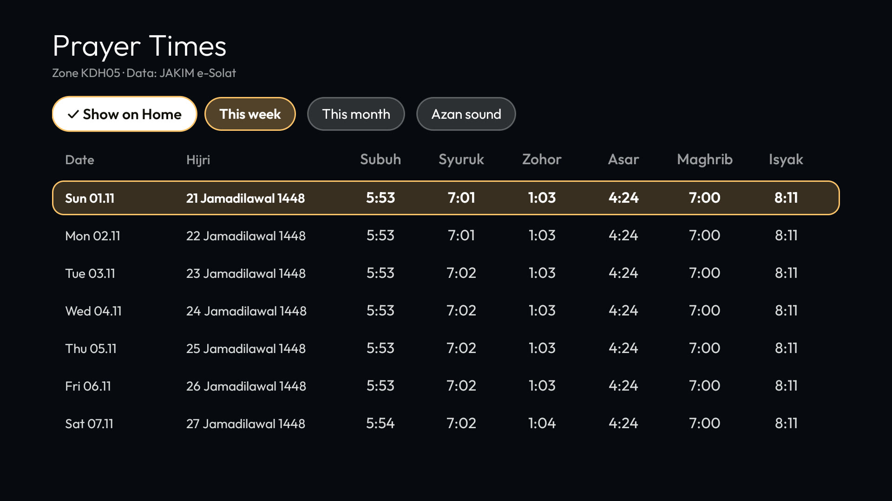
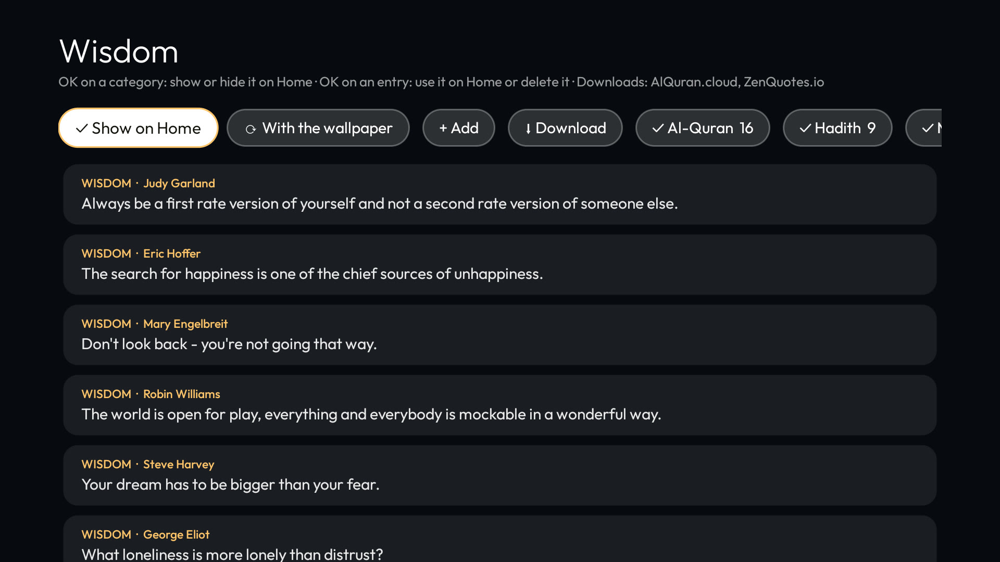
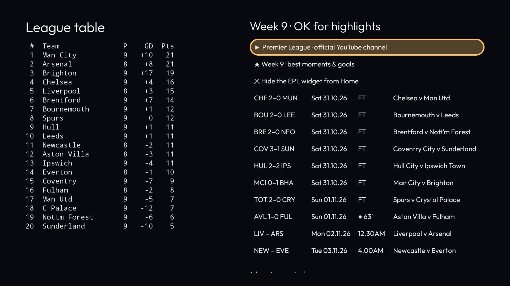
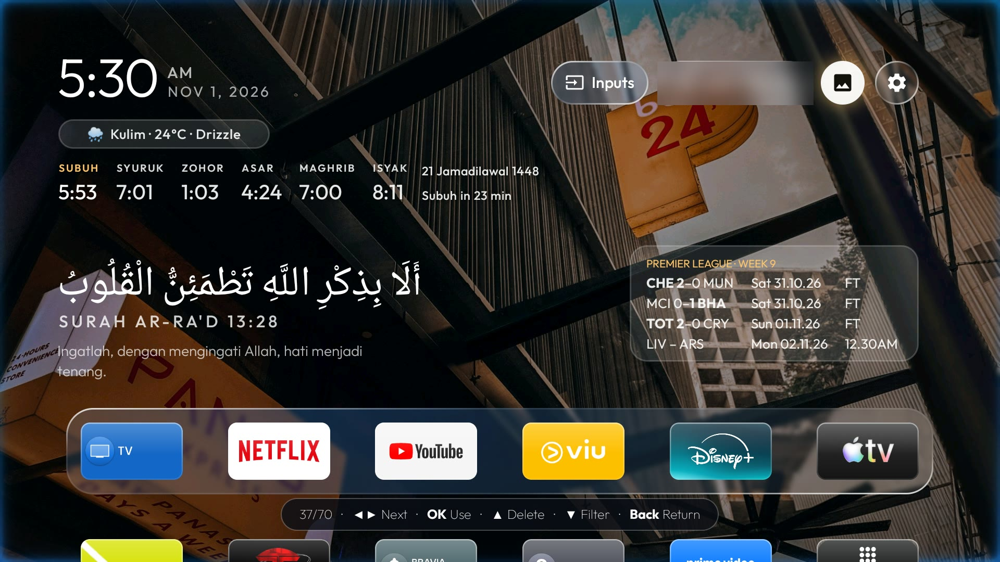
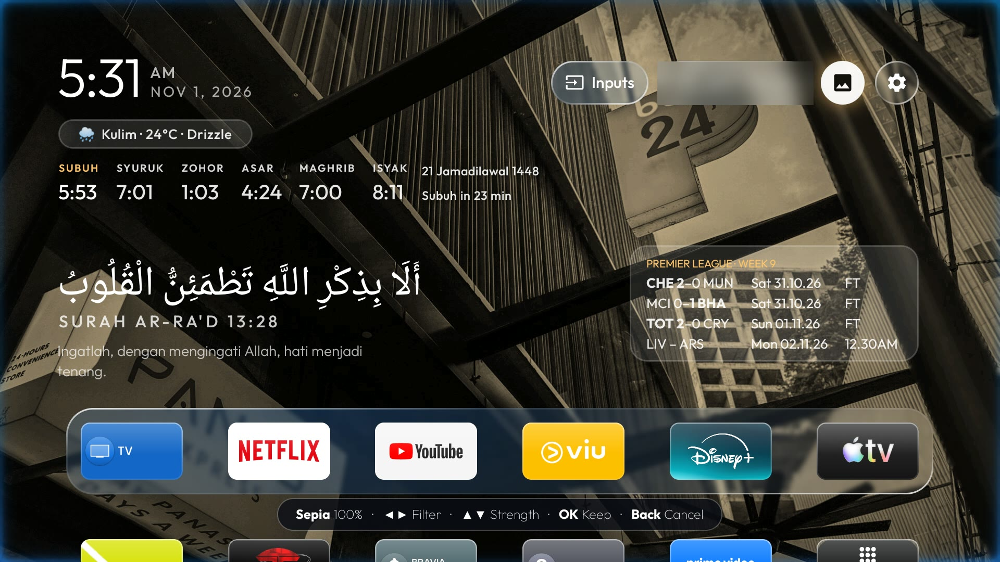
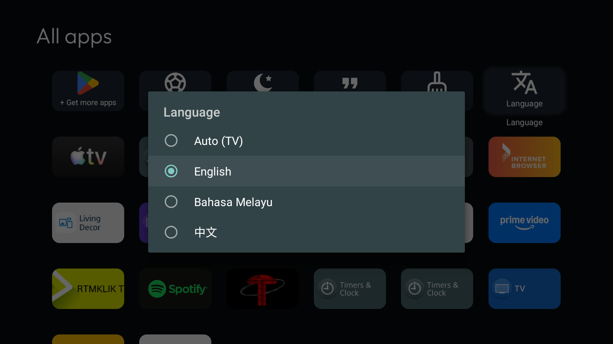

# Glass TV Enhanced: features and user guide

Glass TV Enhanced is a fork of [Glass TV](https://github.com/cocombee/glass-tv) by Gathin (MIT licence). It keeps
everything Glass TV does (the debloat, the frosted-glass home screen, the clock screensaver, the weekly cache
clean) and adds widgets, a wallpaper studio and a choice of language, all driven from an ordinary TV remote.

It was built and tested on a Sony KD-65X8000H (Android TV 10). The setup steps are the same as Glass TV's:
see [CLEANYOURTV-README.md](CLEANYOURTV-README.md) and [AGENTS.md](../AGENTS.md).

## What's new

| Area | What you get |
|---|---|
| **Widgets** | Weather, prayer times, Wisdom (Quran, hadith, motivation, wisdom quotes) and Premier League scores, each one selectable with the remote |
| **Your choice of widgets** | Hold OK on any widget to hide it; bring it back from its own tile in All apps |
| **Wallpaper studio** | Try a picture on the real Home before choosing it, add one of 10 filters at any strength, delete pictures, send photos from a phone |
| **Language** | English, Bahasa Melayu or 中文, or follow the TV; switch any time from All apps |
| **Looks** | A thin edge glow in the selected app's colour that slowly breathes, and a soft vignette |
| **Housekeeping** | The TV's app caches are cleared every day, and a Clear cache tile does it on demand |

## The remote, in one table

| Where | Press | What happens |
|---|---|---|
| Any widget | **OK** | Opens it (the weather page, the league table, other words for Wisdom, the azan sound) |
| Any widget | **Hold OK** (about a second) | Its menu, including **Hide from Home** |
| Dock | **Up** | The widget above that side: Wisdom on the left, Premier League on the right |
| Rows below the dock | **Down** | The widgets fade away so the apps have room, and come back with the dock |
| Wallpaper preview | **◀ ▶** / **OK** / **▲** / **▼** / **Back** | Next picture / use it / delete it / filters / back to the collection |
| Filters | **◀ ▶** / **▲ ▼** / **OK** / **Back** | Next filter / stronger or fainter / keep / cancel |

## Widgets

### Weather
A pill under the clock shows the place, the temperature and the sky ("Kulim · 24°C · Drizzle"). OK opens the
weather page: the weather now, a 7-day strip that slides on, and a detail panel with rain chance, wind, UV,
sunrise and sunset. **Change location** searches any town; **Pick a date** jumps to any of the next 16 days.
Data comes from [Open-Meteo](https://open-meteo.com) (free, no key).

### Prayer times
Today's six times (Malaysia's JAKIM e-Solat, by zone) sit under the weather, with the Hijri date and a
countdown to the next prayer. At each time the TV can play an azan or a chime, even with the widget hidden.
OK on the row chooses the sound; the **Prayer Times** tile in All apps shows the week or the whole month.

### Wisdom
A verse, hadith or saying above the dock: Arabic with its meaning for verses, a single line for short sayings.
OK shows other words. The **Wisdom** tile in All apps manages it:

- **Show on Home**, and which categories Home draws from (Al-Quran, Hadith, Motivation, Wisdom)
- **Use on Home**: OK on any entry keeps that one on Home until you go back to random
- **Change**: with the wallpaper, every 5, 10 or 30 minutes, every hour or every day
- **+ Add**: type your own words on the TV
- **Download**: short Quran verses with Malay or English meanings ([AlQuran.cloud](https://alquran.cloud)), or
  English wisdom quotes ([ZenQuotes](https://zenquotes.io))
- **Delete**: OK on an entry, then Delete

### Premier League
This gameweek's matches for the teams you follow, with the winner in bold and the live minute while a match is
on. OK opens the league table, this week's results with a link to each match's highlights on YouTube, and each
team's next match. The **Premier League** tile in All apps opens the same page, and is where you show the widget
again after hiding it. Data: the Fantasy Premier League API and ESPN's public standings.

### Hiding and showing widgets
Not everyone wants prayer times or football. Hold OK on a widget and choose **Hide from Home**; the widgets
below move up to fill the space. To show it again, open All apps and use its tile: **Premier League**,
**Prayer Times** or **Wisdom**, each with a **Show on Home** button.

## Wallpaper studio

Open the wallpaper button (top right) for your collection.

1. **OK on a picture** puts it on the real Home behind the picker, with the clock and widgets in place.
2. **◀ ▶** tries the next pictures. **OK** keeps the one on screen. **Back** returns with your old wallpaper.
3. **▼ Filters**: Original, Vivid, Warm, Cool, Sepia, Mono, Black & White, Noir, Dramatic and Fade. **▲ ▼**
   sets the strength from 10% to 100%. The filter is kept for that picture only; the file is never changed.
4. **▲ Delete** marks the picture and asks first (Cancel is selected, so a stray OK keeps it).

The icons along the top choose **Auto** (a new picture every few minutes, hours, at each start or each return
to Home), **Fill or Fit**, free wallpaper sites, **upload from a phone** (open the address shown on any phone on
the same Wi-Fi while Home is on screen) and **import** from the Download folder.

| | |
|---|---|
|  |  |

## Language

The **Language** tile in All apps offers Auto (follow the TV), English, Bahasa Melayu and 中文. Home restarts once
in the new language. Prayer names and Hijri months stay as JAKIM writes them, and your Wisdom entries stay in the
language they were written in. To add a language, copy `launcher/app/src/main/res/values/strings.xml` to
`values-<code>/strings.xml` and translate it; no code changes are needed.

## Clear cache

The TV's app caches are cleared once a day while Home sits idle (Glass TV did it every 15 days). The **Clear
cache** tile in All apps does it at once and closes apps left running in the background; a message shows the
storage before and after. The first time, the TV asks "Allow USB debugging?": choose **Always allow**.

## Credits

- [Glass TV](https://github.com/cocombee/glass-tv) by Gathin, MIT licence: the launcher this is built on.
- Azan recordings from Wikimedia Commons, trimmed to the opening takbir:
  "Adhan.ogg" by Aishatu98 (CC0); "Beautiful adhan.ogg" by Adam-synagda (CC0); "Azan.ogg" by Andrewler
  (CC BY-SA 4.0); "Adhan wiki.oga" by Jarih (CC BY-SA 3.0); "The Adhan - Muslim Call to Prayer - Aaqib Azeez.mp3"
  uploaded by Atcovi (CC BY-SA 4.0).
- Weather: Open-Meteo. Prayer times: JAKIM e-Solat. Quran text and translations: AlQuran.cloud. Quotes: ZenQuotes.
  Football: Fantasy Premier League and ESPN.
- Icons: Material Symbols (Apache 2.0).
